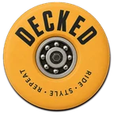

  

  <strong>RIDE. STYLE. REPEAT.</strong> 
  Venice Beach, California. Fictional brand, real storefront.

  <a href="https://bytiagodev.github.io/decked/"><strong>Browse the shop</strong></a>

---

Anyone can open devtools and give themselves a free deck. That is the deal with DECKED: a skate shop with a working storefront and no backend at all, built to see how much of a real store static files and a browser can fake.

You can browse 42 products in six categories, fill a cart, register, check out and come back later to find your order history still there. It is eight plain HTML pages with no router and no build step, so a push to main is the whole deploy.

## Where the store lives

All of it is in `localStorage`. Every product has an ID, and the cart is an array of those IDs with quantities. Registering saves a name and email. Checkout generates an order number, works out shipping, writes the receipt and keeps it across reloads. Stock levels can be flipped from a product page to watch the grid react.

None of it is secure, and it was never meant to be. What it taught me was keeping state consistent across eight separate vanilla JavaScript pages that share nothing but a storage key.

## Golden hour, not grit

Most skate brands go dark and gritty. This one goes to the boardwalk at golden hour: cream ground, coral on the prices, seafoam on every primary button, sunset orange on the low-stock dots. Prices, category tags and stock labels are set in a monospace face, so the numbers always read as data.

---

  
   
  DECKED &copy; 2026 · Built by <a href="https://bytiago.com/en/">Tiago Teixeira</a>

